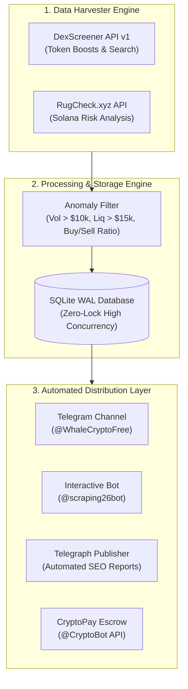

# 🚀 DexScreener Whale Radar, Token Auditor & Telegram Signal Engine

[](https://python.org)
[](https://dexscreener.com)
[](https://rugcheck.xyz)
[](https://t.me/scraping26bot)
[](LICENSE)

An autonomous, multi-threaded Web3 intelligence system that monitors real-time DEX liquidity pools across Solana, Ethereum, Base, and TON. It detects volume breakout anomalies, runs automated RugCheck security audits, calculates volatility take-profit & stop-loss targets, and broadcasts zero-delay signals with an automated CryptoBot payment gateway.

---

## ⚡ Live Demos & Production Showcase

* 📢 **Live Public Signal Channel:** [@WhaleCryptoFree](https://t.me/WhaleCryptoFree) *(Automated 15-min alerts)*
* 🤖 **Interactive Telegram Bot:** [@scraping26bot](https://t.me/scraping26bot) *(Live token scanner & auditor)*
* 📰 **On-Chain Intelligence Briefs:** [Latest Telegraph SEO Report](https://telegra.ph/Whale-Radar-Intelligence-Brief--Oct-16-10-16)

---

## 💎 Commercial Licensing, Turnkey Bot & API Access

| Package | Ideal For | Features | Access |
|---|---|---|---|
| **Open-Source Starter** | Developers & Hobbyists | CLI market scanner, DexScreener polling, terminal logs | **Free (MIT)** |
| **Developer REST API** | Quant Traders & App Builders | Unlimited queries, RugCheck scores, 10 req/s, 99.9% uptime | [**$49/month**](https://yosefdev.my.id/api/checkout?vault=api_sub) |
| **B2B Growth Leads Vault** | Marketing & Outbound Agencies | 5,000 Verified US Agency Founder Emails, LinkedIn, Rev stats | [**$29 once**](https://yosefdev.my.id/us-leads/) |
| **Turnkey Whitelabel Bot** | Web3 Founders & Entrepreneurs | Full source code, PM2 configs, CryptoBot cashier, 100% rebrand rights | [**$199 once**](https://yosefdev.my.id/api/checkout?vault=whitelabel_bot) |

[](https://yosefdev.my.id/api/checkout?vault=whitelabel_bot)
[](https://yosefdev.my.id/api/checkout?vault=api_sub)
[](https://t.me/WhaleCryptoFree)

---

## 🏗️ Architecture Overview



---

## 🚀 Quickstart: Open-Source Starter Scanner

Run your own local market breakout scanner in under 2 minutes:

### 1. Clone & Install Dependencies
```bash
git clone https://github.com/yosef-lib/scraper.git
cd scraper
pip install -r requirements.txt
```

### 2. Configure Environment (Optional)
```bash
cp .env.example .env
# Fill in your TELEGRAM_BOT_TOKEN if you want channel forwarding
```

### 3. Run the Starter Anomaly Hunter
```bash
python starter_whale_radar.py
```

Sample output:
```text
[INFO] 🔍 Scanning DexScreener for live breakout anomalies...
[ANOMALY] $GTA (SOLANA)
• Price: $0.003412 | 1h Change: +14.82%
• 1h Volume: $48,290.00 | Liquidity: $32,150.00
• Buy/Sell Ratio: 2.45x (Bullish Accumulation)
• Risk Score: Good (RugCheck Verified)
• CA: 4k3Dyjzvzp8eMZWUXbBCjEvwSkkk59S5iCNLY3QrkX6R
```

---

## 🔒 Enterprise & Production Grade Features (Included in $199 Whitelabel)

1. **Zero Fake Data (Anti-Scam):** 100% verified on-chain data directly from DEX liquidity pools.
2. **Safe Concurrency & WAL Mode:** SQLite configured with `PRAGMA journal_mode=WAL;` and `PRAGMA synchronous=NORMAL;` ensuring zero `database is locked` crashes under high load.
3. **Automated Crypto Cashier:** Integrated `@CryptoBot` background polling (15s intervals). No domain, no SSL, and no webhooks required—runs out of the box on any Linux VPS.
4. **Daemonized 24/7 PM2 Config:** Production `ecosystem.config.js` with auto-restart on memory spikes or server reboots.

---

## 🤝 Support & Inquiries

* **Developer Email:** `support@yosefdev.my.id`
* **Telegram:** [@scraping26bot](https://t.me/scraping26bot)
* **Official Channel:** [@WhaleCryptoFree](https://t.me/WhaleCryptoFree)

---
*Distributed under the Dual MIT & Commercial Whitelabel License. Built with ❤️ for Web3 Traders and Developers worldwide.*
